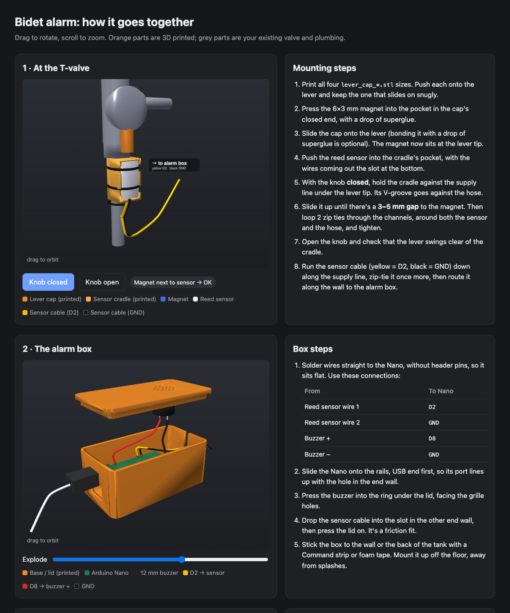
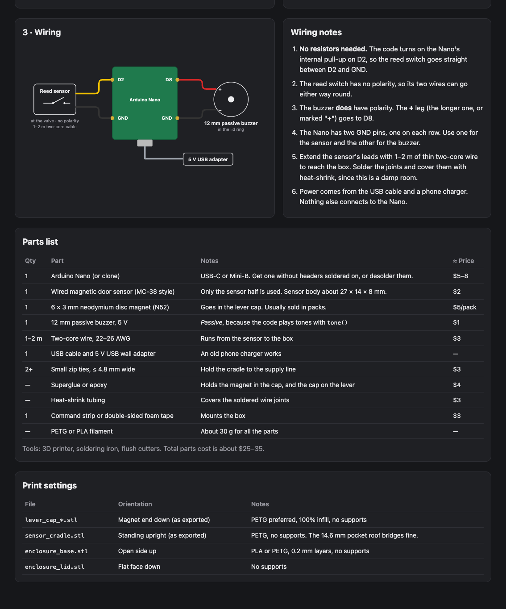

# Bidet Alarm

A small device that beeps if the handheld bidet sprayer's T-valve is left open for more than 10 minutes. A magnet on the valve lever moves away from a reed sensor when the knob is turned on. An Arduino Nano starts a timer and sounds a buzzer if the knob isn't turned back off.

Built for an **Arofa handheld bidet sprayer** with a 7/8" T-valve. The lever points down when the valve is closed and sideways when it's open. Other T-valves with a lever handle should work after adjusting the parameters.



## How it works

1. A printed **lever cap** with a 6×3 mm magnet slips over the valve lever.
2. A printed **sensor cradle** zip-ties to the supply line and holds a reed sensor just under the lever tip.
3. **Closed:** the magnet sits next to the sensor, the switch is closed and D2 reads LOW.
4. **Open:** the lever swings 90°, the switch opens and a 10-minute timer starts.
5. If the valve is still open after 10 minutes, the buzzer sounds and repeats every 30 s until someone closes it.

Open **`assembly.html`** in a browser for the interactive 3D assembly. It has an open/close animation, an exploded view of the box with the wires, a wiring diagram, the parts list and print settings.


## Repo layout

| Path | What |
|---|---|
| `print/` | Ready-to-print STL files |
| `firmware/bidet_alarm/bidet_alarm.ino` | Arduino sketch |
| `assembly.html` + `assembly_data.js` | 3D assembly viewer |
| `bidet_alarm_parts.py` | Parametric generator for the STLs and the viewer data |
| `docs/` | Screenshots |

## Parts list

| Qty | Part | Notes | ≈ Price |
|---|---|---|---|
| 1 | [Arduino Nano (or clone)](https://www.amazon.com/s?k=arduino+nano+usb-c+without+headers) | USB-C or Mini-B, preferably without headers soldered on | $5–8 |
| 1 | [Wired magnetic door sensor, MC-38 style](https://www.amazon.com/s?k=MC-38+wired+magnetic+door+sensor+reed+switch) | Only the sensor half is used. Body about 27 × 14 × 8 mm. | $2 |
| 1 | [6 × 3 mm N52 neodymium disc magnet](https://www.amazon.com/s?k=6x3mm+neodymium+disc+magnet+N52) | Goes in the lever cap | $5/pack |
| 1 | [12 mm passive buzzer, 5 V](https://www.amazon.com/s?k=12mm+passive+buzzer+5V) | Must be *passive*, because the code uses `tone()` | $1 |
| 1–2 m | [Two-core wire, 22–26 AWG](https://www.amazon.com/s?k=22+awg+2+conductor+wire) | Runs from the sensor to the box | $3 |
| 1 | USB cable and 5 V USB wall adapter | An old phone charger works | — |
| 2+ | [Small zip ties, ≤ 4.8 mm wide](https://www.amazon.com/s?k=small+zip+ties+4+inch) | Hold the cradle to the supply line | $3 |
| — | Superglue or epoxy | Holds the magnet in the cap | $4 |
| — | [Heat-shrink tubing](https://www.amazon.com/s?k=heat+shrink+tubing+kit) | Covers the soldered joints | $3 |
| 1 | Command strip or double-sided foam tape | Mounts the box | $3 |
| — | PETG or PLA filament | About 30 g in total | — |

The links are Amazon search pages rather than specific listings, because individual listings change often. Before you buy, check that the door sensor's body is close to 27 × 14 × 8 mm and that the buzzer says **passive**.

**Tools:** 3D printer, soldering iron, flush cutters.

## Wiring

| From | To Nano |
|---|---|
| Reed sensor wire 1 | `D2` |
| Reed sensor wire 2 | `GND` |
| Buzzer + | `D8` |
| Buzzer − | `GND` (the GND pin on the other row) |

You don't need any resistors, because the sketch turns on the Nano's internal pull-up on D2. Power comes over USB.



## Printing

| File | Orientation | Notes |
|---|---|---|
| `lever_cap_5.6mm.stl` … `lever_cap_6.8mm.stl` | Magnet end down | Print all four and keep the one that fits the lever snugly. PETG, 100% infill. |
| `sensor_cradle.stl` | Upright | PETG, no supports |
| `enclosure_base.stl` | Open side up | No supports |
| `enclosure_lid.stl` | Flat face down | No supports |

## Assembly

**At the valve**

1. Glue the magnet into the cap's end pocket, then push the cap onto the lever.
2. Put the reed sensor in the cradle, with its wires coming out of the bottom slot.
3. With the knob **closed**, hold the cradle's V-groove against the supply line. Slide it up until it's 3–5 mm below the magnet, then zip-tie it through the two channels.
4. Open the knob and check that the lever swings clear of the cradle.
5. Run the sensor cable (yellow = D2, black = GND) down the supply line, zip-tie it once more, then route it along the wall to the box.

**The box**

1. Solder the wires to the Nano (see the wiring table above).
2. Slide the Nano onto the rails with the USB port facing the end hole.
3. Press the buzzer into the ring in the lid.
4. Route the sensor cable through the slot, close the lid and mount the box off the floor.

## Firmware

Open `firmware/bidet_alarm/bidet_alarm.ino` in the Arduino IDE and upload it to the Nano. Some clones need **Tools → Processor → ATmega328P (Old Bootloader)**.

To test, set `ALARM_DELAY` to `10UL * 1000UL` (10 s). Open the knob and it should beep after 10 s. Close it and the beeping stops. Change the delay back to 10 minutes when you're done.

## Loudness

A 12 mm passive buzzer is rated at about **80–85 dB at 10 cm**, at its resonant frequency (around 2.3–2.7 kHz). The sketch alternates 2.7 and 2.3 kHz to stay near that peak. In practice, it's easy to hear in the bathroom and the next room, but it's unlikely to carry across the house with doors closed. For a louder alarm:

- Use a **larger passive piezo**, 23–30 mm. It's a drop-in swap on D8 and GND.
- Use a **5 V active piezo siren** (95 dB or more), switched by an NPN transistor or MOSFET on D8.
- Use a **DFPlayer Mini with a 3 W speaker** to play a recorded voice message.

## Customising the parts

Edit the parameters at the top of `bidet_alarm_parts.py`, then regenerate:

```bash
pip install manifold3d trimesh numpy
python bidet_alarm_parts.py
```

These are the key parameters:

- `LEVER_BORES`: cap bore sizes
- `STANDOFF`: distance from the supply hose's centre to the lever, about 14 mm
- `PIPE_D`: supply hose diameter
- `SENSOR_W`, `SENSOR_D`, `SENSOR_L`: your reed sensor's body size

The defaults are estimates taken from a video of the valve, so measure yours before printing.
