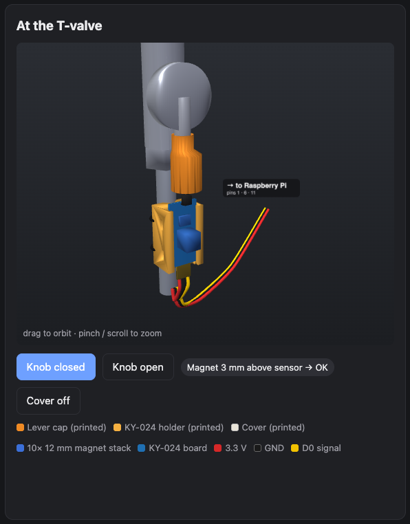
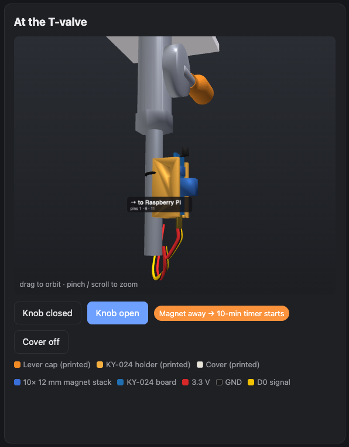
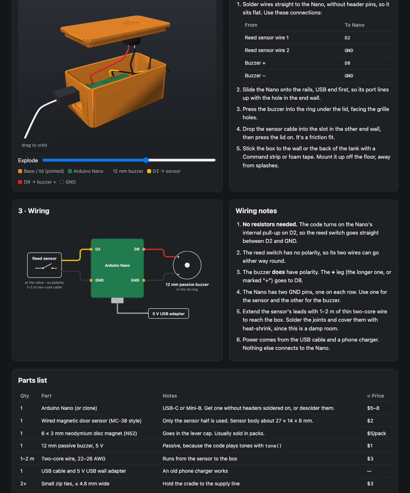

# Bidet Alarm

A small device that sounds an alarm if the handheld bidet sprayer's T-valve is left open for more than 10 minutes. A magnet on the valve lever moves away from a sensor when the knob is turned on; a timer starts, and if the knob isn't turned back off, a speaker plays an alarm.

Built for an **Arofa handheld bidet sprayer** with a 7/8" T-valve. The lever points down when the valve is closed and sideways when it's open. Other T-valves with a lever handle should work after adjusting the parameters.

## Current build: Raspberry Pi + KY-024 Hall sensor

This is the version being built. It uses parts already on hand: a Raspberry Pi 4B, a KY-024 Hall sensor board, a stack of ten 12 mm neodymium magnets and a USB speaker. The interactive plan page is [`pi-design/index.html`](pi-design/index.html); serve the repo with `python3 -m http.server 8765` and open `/pi-design/index.html`.

| Valve closed: magnet 3 mm above the sensor | Valve open: magnet swings away, timer starts |
|---|---|
|  |  |

The printed **lever cap** (orange) holds the magnet stack on the lever tip. The **holder** (yellow) zip-ties to the supply hose and holds the KY-024 board (blue) under the cap, and a printed **cover** slides over it as a splash guard:


### Wiring

Three wires from the KY-024 to the Pi's 40-pin header. **Use 3.3 V (pin 1), never 5 V**: the sensor's D0 output follows its supply voltage, and the Pi's GPIO pins are damaged by 5 V.

| KY-024 pin | Pi pin | |
|---|---|---|
| **+** | **1** (3.3 V) | inner row, the corner farthest from the USB ports |
| **G** | **6** (GND) | outer row, 3rd from that end (pin 9 is also GND) |
| **D0** | **11** (GPIO17) | inner row, 6th from that end |
| A0 | not connected | |


On this board **D0 reads 1 when the magnet is near** (valve closed). That's set with `MAGNET_NEAR_VALUE=1` in `pi/bidet-alarm.service`.


### Print files (`pi-design/print/`)

| File | Print | Notes |
|---|---|---|
| `lever_cap_7.7mm.stl`, `7.9mm`, `8.1mm` | Magnet end down, 100% infill | Lever measured 7.7 mm. Print all three, keep the snug one (7.9 is the likely fit). |
| `ky024_holder.stl` | Upright, no supports | Board slides in from the top, pins down. Sized for a 34.7 × 15.3 mm board. |
| `ky024_cover.stl` | Front face down, no supports | Splash guard; 0.8 mm roof over the sensor. |

PETG is preferred in a bathroom. The parts are generated by `pi-design/pi_parts.py` (needs `manifold3d trimesh numpy`).

### Pi software

- `pi/setup_from_mac.sh`: after flashing Raspberry Pi OS Lite (hostname `bidet-alarm`, SSH key), waits for the Pi, copies this repo to it and installs `gpiozero`, `lgpio` and `alsa-utils`.
- `pi/bidet_alarm.py`: `--calibrate` prints the sensor live, `--test` alarms after 10 s, no flag is the normal 10-minute run.
- `pi/bidet-alarm.service`: starts the alarm at boot.

---

# Original design: Arduino Nano + reed switch

This was the first design. It's kept for reference and isn't being built. Its STLs are in the top-level `print/` folder.


## How it works

1. A printed **lever cap** with a 6×3 mm magnet slips over the valve lever.
2. A printed **sensor cradle** zip-ties to the supply line and holds a reed sensor just under the lever tip.
3. **Closed:** the magnet sits next to the sensor, the switch is closed and D2 reads LOW.
4. **Open:** the lever swings 90°, the switch opens and a 10-minute timer starts.
5. If the valve is still open after 10 minutes, the buzzer sounds and repeats every 30 s until someone closes it.

**Alternate build with parts you may already have:** [`pi-design/`](pi-design/index.html) uses a Raspberry Pi 4B, a KY-024 Hall sensor and a USB speaker. It has its own plan page, a sensor holder and `pi/bidet_alarm.py`.

Open **`assembly.html`** in a browser for the interactive 3D assembly. It has an open/close animation, an exploded view of the box with the wires, a wiring diagram, the parts list and print settings.



## Repo layout

| Path | What |
|---|---|
| `print/` | Ready-to-print STL files |
| `firmware/bidet_alarm/bidet_alarm.ino` | Arduino sketch |
| `assembly.html` + `assembly_data.js` | 3D assembly viewer |
| `bidet_alarm_parts.py` | Parametric generator for the STLs and the viewer data |
| `pi-design/`, `pi/` | Current build: Raspberry Pi plan page, printable parts and alarm software |
| `docs/` | Screenshots (`docs/pi/` for the current build) |

## Parts list

| Qty | Part | Notes | ≈ Price |
|---|---|---|---|
| 1 | [Arduino Nano clone, USB-C, 3-pack (AYWHP)](https://www.amazon.com/dp/B0DFGX3MSL) | Headers come loose, and a USB-C cable is included | $14 |
| 1 | [uxcell MC-38 wired door sensor, NC, 2-pack](https://www.amazon.com/dp/B07F5XL9N8) | Only the sensor half is used. Body 27 × 14 × 7.5 mm, 26 cm leads | $10 |
| 1 | [6 × 3 mm round magnets, 80-pack (rhinocats)](https://www.amazon.com/dp/B0FMP58G7B) | Goes in the lever cap | $7.49 |
| 1 | [Cylewet 5 V active buzzer, 12 mm, 10-pack](https://www.amazon.com/dp/B01N7NHSY6) | *Active* type, under 25 mA, so it's safe to drive straight from a Nano pin | $6.99 |
| 10 ft | [Haerkn 22 AWG two-core silicone wire](https://www.amazon.com/dp/B0B9JCJMNP) | Extends the sensor's 26 cm leads to the box | $4.66 |
| 1 | 5 V USB wall adapter | Any phone charger works. The USB-C cable comes with the Nano. | — |
| 2+ | [Small zip ties, ≤ 4.8 mm wide](https://www.amazon.com/s?k=small+zip+ties+4+inch) | Hold the cradle to the supply line | $3 |
| — | Superglue or epoxy | Holds the magnet in the cap | $4 |
| — | [Heat-shrink tubing](https://www.amazon.com/s?k=heat+shrink+tubing+kit) | Covers the soldered joints | $3 |
| 1 | Command strip or double-sided foam tape | Mounts the box | $3 |
| — | PETG or PLA filament | About 30 g in total | — |

The links go to the exact listings this design was checked against. If you substitute parts, keep these the same:

- The door sensor must be **MC-38, NC type**, with a body of about 27 × 14 × 7.5 mm. If yours is sold as NO, set `SENSOR_IS_NO = true` in the firmware.
- The buzzer must be a **5 V active** buzzer that draws under 30 mA. Most 12 mm "passive" buzzers are 16–42 Ω electromagnetic types. Those draw over 100 mA, which can damage a Nano pin.

**Tools:** 3D printer, soldering iron, flush cutters.

## Wiring

| From | To Nano |
|---|---|
| Reed sensor wire 1 | `D2` |
| Reed sensor wire 2 | `GND` |
| Buzzer + | `D8` |
| Buzzer − | `GND` (the GND pin on the other row) |

You don't need any resistors, because the sketch turns on the Nano's internal pull-up on D2. Power comes over USB.


## Printing

| File | Orientation | Notes |
|---|---|---|
| `lever_cap_7.7mm.stl`, `7.9mm`, `8.1mm` | Magnet end down | Lever measured at 7.7 mm. Print all three (7.9 is the likely snug fit) and keep the one that fits. PETG, 100% infill. |
| `sensor_cradle.stl` | Upright | PETG, no supports |
| `enclosure_base.stl` | Open side up | No supports |
| `enclosure_lid.stl` | Flat face down | No supports |

## Assembly

**At the valve**

1. Glue the magnet into the cap's end pocket. Push the cap onto the lever with its **flat side facing the valve body**.
2. Put the reed sensor in the cradle, with its wires coming out of the bottom slot.
3. With the knob **closed**, hold the cradle's V-groove against the supply line. Slide it up until it's **2–3 mm** below the magnet. The recess at the top-back lets it ride up in front of the nut. Power the Nano: its built-in LED must be **off** with the knob closed and **on** with it open. Then zip-tie it through the two channels.
4. Open the knob and check that the lever swings clear of the cradle.
5. Run the sensor cable (yellow = D2, black = GND) down the supply line, zip-tie it once more, then route it along the wall to the box.

**The box**

1. Solder the wires to the Nano (see the wiring table above).
2. Slide the Nano onto the rails with the USB port facing the end hole.
3. Press the buzzer into the ring in the lid.
4. Route the sensor cable through the slot, close the lid and mount the box off the floor.

## Firmware

Open `firmware/bidet_alarm/bidet_alarm.ino` in the Arduino IDE and upload it to the Nano. Some clones need **Tools → Processor → ATmega328P (Old Bootloader)**.

To test, set `ALARM_DELAY` to `10UL * 1000UL` (10 s). Open the knob and it should beep after 10 s. Close it and the beeping stops. Change the delay back to 10 minutes when you're done.

## Loudness

The Cylewet active buzzer is rated at about **85 dB at 10 cm**. That's easy to hear in the bathroom and the next room, but probably not across the house with doors closed. The sketch beeps six times in a row and repeats every 30 seconds until the valve is closed. For a louder alarm:

- Use a **5 V active piezo siren** (95 dB or more, often 3–24 V), switched by an NPN transistor on D8.
- Use a **DFPlayer Mini with a 3 W speaker** to play a recorded voice message.

## Design checks

`bidet_alarm_parts.py` builds the assembly. The checks below were run against it, using reference geometry estimated from a video of the valve:

- No collisions between the cap, cradle, sensor, valve, nut and supply line with the knob closed.
- The lever and cap swing from 0° to 90° without touching the cradle.
- Closed: 3.3 mm from the magnet face to the sensor body. The sensor is rated to trigger at 10–15 mm with its own larger magnet.
- Open: 45 mm from the magnet to the sensor, so the switch reliably opens.
- Box: the Nano, buzzer, rails, ring and lid don't collide, and there's about 4 mm of clearance above the Nano for wires.
- Firmware compiles for `arduino:avr:nano` (2.5 KB, 8% of flash).

The real valve may differ from these estimates. Print the cap and cradle first and test-fit them.

## Customising the parts

Edit the parameters at the top of `bidet_alarm_parts.py`, then regenerate:

```bash
pip install manifold3d trimesh numpy
python bidet_alarm_parts.py
```

These are the key parameters:

- `LEVER_BORES`: cap bore sizes
- `STANDOFF`: distance from the supply hose's centre to the lever, about 14 mm
- `PIPE_D`: supply hose diameter
- `SENSOR_W`, `SENSOR_D`, `SENSOR_L`: your reed sensor's body size

The defaults are estimates taken from a video of the valve, so measure yours before printing.
