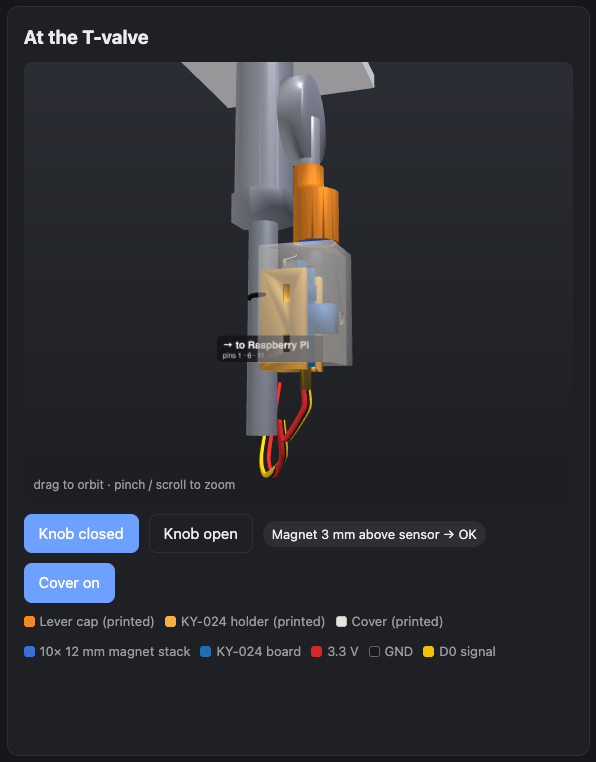
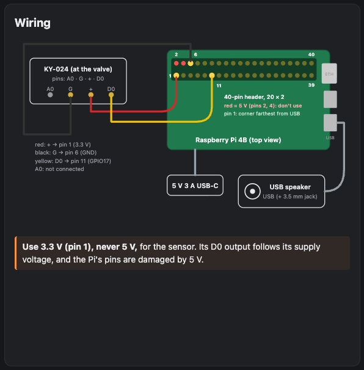
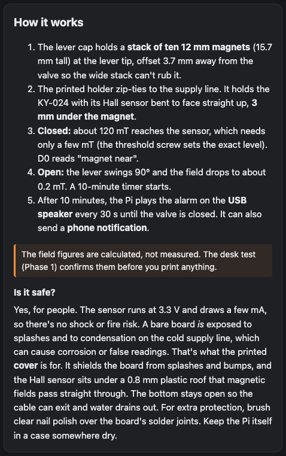

# Bidet Alarm

A small device that sounds an alarm if the handheld bidet sprayer's T-valve is left open for more than 10 minutes. A magnet on the valve lever moves away from a sensor when the knob is turned on; a timer starts, and if the knob isn't turned back off, a speaker plays an alarm.

Built for an **Arofa handheld bidet sprayer** with a 7/8" T-valve. The lever points down when the valve is closed and sideways when it's open. Other T-valves with a lever handle should work after adjusting the parameters.

## Current build: Raspberry Pi + KY-024 Hall sensor

This is the version being built. It uses parts already on hand: a Raspberry Pi 4B, a KY-024 Hall sensor board, a stack of ten 12 mm neodymium magnets and a USB speaker. The interactive plan page is [`pi-design/index.html`](pi-design/index.html); serve the repo with `python3 -m http.server 8765` and open `/pi-design/index.html`.

| Valve closed: magnet 3 mm above the sensor | Valve open: magnet swings away, timer starts |
|---|---|
|  |  |

The printed **lever cap** (orange) holds the magnet stack on the lever tip. The **holder** (yellow) zip-ties to the supply hose and holds the KY-024 board (blue) under the cap, and a printed **cover** slides over it as a splash guard:

### Wiring

Three wires from the KY-024 to the Pi's 40-pin header. **Use 3.3 V (pin 1), never 5 V**: the sensor's D0 output follows its supply voltage, and the Pi's GPIO pins are damaged by 5 V.

| KY-024 pin | Pi pin | |
|---|---|---|
| **+** | **1** (3.3 V) | inner row, the corner farthest from the USB ports |
| **G** | **6** (GND) | outer row, 3rd from that end (pin 9 is also GND) |
| **D0** | **11** (GPIO17) | inner row, 6th from that end |
| A0 | not connected | |

On this board **D0 reads 1 when the magnet is near** (valve closed). That's set with `MAGNET_NEAR_VALUE=1` in `pi/bidet-alarm.service`.

### Print files (`print/`)

| File | Print | Notes |
|---|---|---|
| `lever_cap_7.3mm.stl` … `8.1mm` | Magnet end down, 100% infill, brim | Lever measured 7.7 mm; 7.9 and 7.7 tested too loose. Print one at a time from 7.5 down and keep the first snug one. |
| `pi4_case_base.stl` | Open side up, no supports | Pi 4 case base. The Pi drops onto 4 pegs; USB-A end open, 18 × 12.5 mm USB-C opening for chunky plugs. |
| `pi4_case_lid.stl` | Top face down, no supports | Lid with a slot over the 40-pin header (▲ = pin 1) and posts that hold the Pi down. 3D view: `pi-design/case.html`. |
| `ky024_holder.stl` | Upright, no supports | Board slides in from the top, pins down. Sized for a 34.7 × 15.3 mm board. |
| `ky024_cover.stl` | Front face down, no supports | Splash guard; 0.8 mm roof over the sensor. |

PETG is preferred in a bathroom. The parts are generated by `pi-design/pi_parts.py` (needs `manifold3d trimesh numpy`) and written to `print/`.

### Setting up the Pi

The OS image itself isn't in this repo: it's about 500 MB and Raspberry Pi Imager downloads the official one. What the repo keeps is the recipe for the card's first boot (`pi/firstboot/`), so re-flashing gives the same Pi every time.

1. In **Raspberry Pi Imager**, pick Raspberry Pi 4 → **Raspberry Pi OS Lite (64-bit)** → the microSD card, choose **no customisation**, and write it.
2. With the card still in the Mac, run `./pi/prepare_sd_card.sh <wifi-name>`. It asks for the Wi-Fi password in a macOS dialog and writes the first-boot settings to the card: hostname `bidet-alarm`, user `pi` with your Mac's SSH key (no password login), Wi-Fi, US/Pacific time. The Wi-Fi password is stored on the card only as a WPA key hash and never in this repo. Then it ejects the card.
3. Put the card in the Pi and power it on. First boot takes 2-3 minutes.
4. Run `./pi/setup_from_mac.sh`. It waits for `bidet-alarm.local`, checks SSH and Wi-Fi, copies this repo to the Pi and installs `gpiozero`, `lgpio` and `alsa-utils`. After that, `ssh bidet-alarm` logs straight in. (On a new Mac, first add the `Host bidet-alarm` block from the top of `pi/setup_from_mac.sh` to `~/.ssh/config`.)

### Pi software

- `pi/bidet_alarm.py`: `--calibrate` prints the sensor reading live, `--test` alarms after 10 s, no flag is the normal 10-minute run.
- `pi/bidet-alarm.service`: starts the alarm at boot (`sudo cp pi/bidet-alarm.service /etc/systemd/system/ && sudo systemctl enable --now bidet-alarm`).
- `pi/prepare_sd_card.sh`, `pi/setup_from_mac.sh`, `pi/firstboot/`: the setup steps above.

## Repo layout

| Path | What |
|---|---|
| `print/` | **The STL files to print** (lever cap, sensor holder, sensor cover) |
| `pi-design/index.html` | Interactive plan page: 3D view, wiring, build checklist |
| `pi-design/pi_parts.py` | Parametric generator for the STLs and the 3D view |
| `pi/` | Alarm software for the Pi, the boot service, and the SD-card and Mac setup scripts (`pi/firstboot/` holds the first-boot config templates) |
| `docs/pi/` | Screenshots used in this README |
| `archive/nano-design/` | The first design (Arduino Nano + reed switch + buzzer box). Not being built. |
